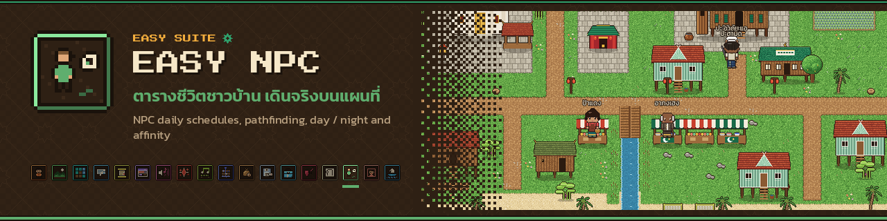
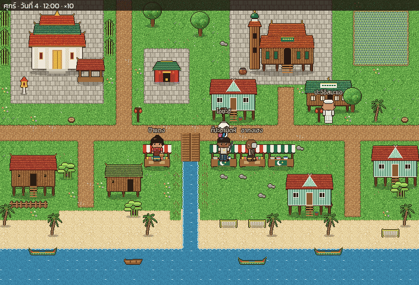
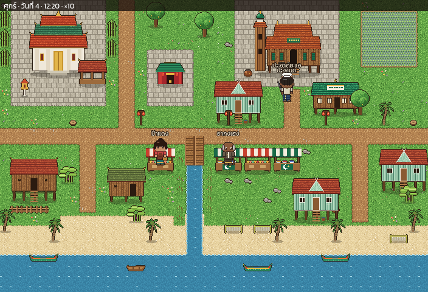
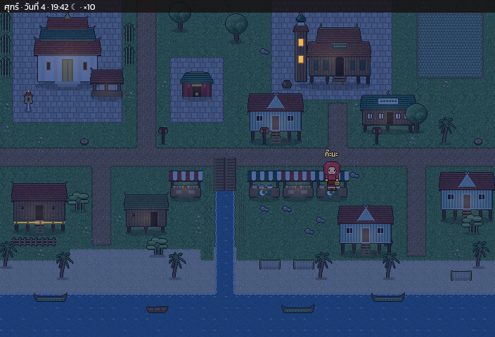
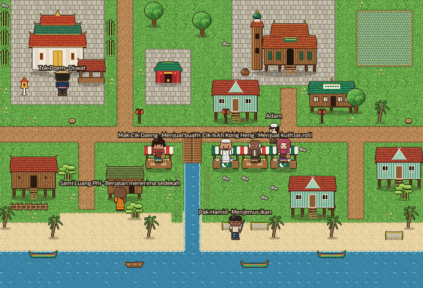
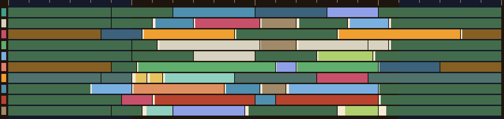
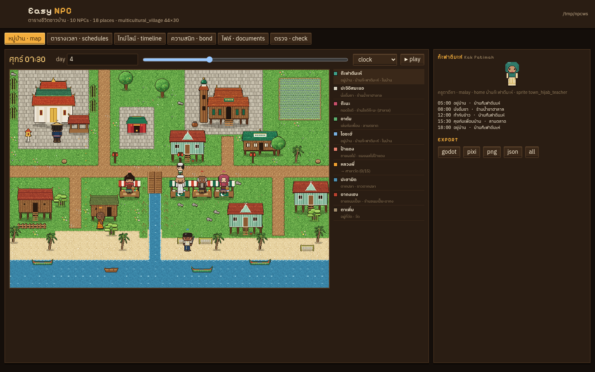

<!-- easy-suite:header:start -->
<p align="center">
  <a href="#easy-suite"></a>
</p>

<p align="center">
  <b>Easy NPC</b> · ตารางชีวิตชาวบ้าน เดินจริงบนแผนที่ · NPC daily schedules, pathfinding, day / night and affinity<br />
  <sub>Part of <a href="#easy-suite"><b>Easy Suite</b></a>: Thai-friendly pixel-art game dev tools for Godot 4.3+ and PixiJS v8</sub>
</p>

<p align="center">
  <a href="https://github.com/Saladin2020/easynpc/actions/workflows/ci.yml"></a> <a href="LICENSE"></a>   <a href="docs/MCP.md"></a> 
</p>

<p align="center">
  <a href="https://github.com/Saladin2020/easysprite"></a>
  <a href="https://github.com/Saladin2020/easyscene"></a>
  <a href="https://github.com/Saladin2020/easytilemap"></a>
  <a href="https://github.com/Saladin2020/easydialogue"></a>
  <a href="https://github.com/Saladin2020/easyquest"></a>
  <a href="https://github.com/Saladin2020/easyui"></a>
  <a href="https://github.com/Saladin2020/easysfx"></a>
  <a href="https://github.com/Saladin2020/easyfx"></a>
  <a href="https://github.com/Saladin2020/easymusic"></a>
  <a href="https://github.com/Saladin2020/easyanim"></a>
  <a href="https://github.com/Saladin2020/easyitems"></a>
  <a href="https://github.com/Saladin2020/easysave"></a>
  <a href="https://github.com/Saladin2020/easykit"></a>
  <a href="https://github.com/Saladin2020/easybattle"></a>
  <a href="https://github.com/Saladin2020/easyfont"></a>
  <a href="https://github.com/Saladin2020/easynpc"></a>
  <a href="https://github.com/Saladin2020/easyportrait"></a>
  <a href="https://github.com/Saladin2020/easyship"></a>
</p>
<!-- easy-suite:header:end -->

# Easy NPC

**ตารางชีวิตชาวบ้าน · เดินจริงบนแผนที่ · กลางวัน/กลางคืน · ความสนิท · ไทย Bahasa Melayu English**  
Give the people of your village a day: when Kak Na opens her roti stall, when the men walk to the mosque on Friday,
when หลวงพี่ goes on his alms round, who sits at the tea stall at night. Easy NPC turns **daily schedules** into
**walking NPCs** on an [Easy Tilemap](../easytilemap) map — A* pathfinding over its collision grid, day / night
variants, weekday-only entries, indoors hiding — plus **affinity** (talk once a day, gifts by taste, levels that open
new [Easy Dialogue](../easydialogue) nodes and [Easy Quest](../easyquest) quests). Exports a **Godot 4.3+** `NPCs`
autoload with an `EasyNpcWorld` node and a **PixiJS v8** runtime, both running the same engine (parity-tested).
CLI, web editor and MCP server; local only, no network.

<p align="center"></p>

| Godot 4.3 demo, Friday 12:20 | Godot, 19:40 (night map, Kak Na's night roti) | PixiJS v8 demo (Malay labels + activities) |
|---|---|---|
|  |  |  |

## The sample village

`init` copies a multicultural seaside village (44×30 tiles, rendered by Easy Tilemap without its baked characters,
day and night) with ten neighbours who use the Easy Sprite town sheets:

| NPC | Who | A day |
|---|---|---|
| ก๊ะฟาตีมะห์ (Kak Fatimah) | tadika teacher | tadika on Saturday and Sunday, tea at the halal stall on weekdays, cooking, chatting at the market |
| ปะจิอิสมะแอ (Pak Cik Ismail) | village carpenter | tea, sweeping the tadika, Friday prayer at the mosque, fixing boats by day |
| ก๊ะนะ (Kak Na) | roti seller (halal stall) | cooks before dawn, roti in the morning and afternoon, keeps the stall open after dark |
| อาดัม (Adam) | Ton's best friend | tadika on weekends, the market and the beach, Friday prayer |
| ไอชะฮ์ (Aisyah) | tadika pupil | tadika on weekends, market, a walk on the beach |
| ป้าแดง (Auntie Daeng) | fruit seller | fruit stall all day, lunch chat at the tea stall |
| หลวงพี่ (Luang Phi) | village monk | alms round at dawn, the sala, sweeping in the afternoon |
| ปะฮามิด (Pak Hamid) | kolek fisherman | boats before dawn, drying fish, tea, Friday prayer |
| อากงเฮง (Ah Kong Heng) | pastry stall owner | sweeps the shrine, sells sweets, lunch at the halal tea stall |
| ตาเพิ่ม (Grandpa Poem) | retired farmer | temple in the morning, the sala, an evening walk on the beach |

Places and activities have Thai / English / Malay names; Thai names are written in Thai. Gifts for Malay-Muslim
neighbours are checked to be halal; NPCs never depict sacred figures.

<p align="center"></p>

## Quick start

```bash
npm install
npx tsx src/cli.ts init --workspace ~/my-village          # npcs/ maps/ characters/ dialogues/ quests/
npx tsx src/cli.ts where --day 4 --at 12:45 --workspace ~/my-village
npx tsx src/cli.ts schedule kakna --day 4 --workspace ~/my-village
npx tsx src/cli.ts render map --day 4 --at 07:30 --scale 2 --out village.png --workspace ~/my-village
npx tsx src/cli.ts export --workspace ~/my-village         # exports/easynpc-{godot,pixi,png,json}/
npx tsx src/cli.ts serve --workspace ~/my-village          # web editor on http://127.0.0.1:8958
```

Other commands: `info`, `list npcs|places|activities`, `path <from> <to>`, `bond <npc> --days 7 --gift kurma`,
`set-entry <npc> <HH:MM> <place> <activity> [--days sat,sun] [--when night] [--indoors] [--dialogue id#node]`,
`remove-entry`, `check`, `render timeline`.

## How schedules work

```json
{ "id": "kakna", "name": { "th": "ก๊ะนะ", "en": "Kak Na", "ms": "Kak Na" }, "sprite": "town_roti_seller",
  "culture": "malay", "home": "house_makyah",
  "schedule": [
    { "at": "04:30", "place": "house_makyah", "activity": "cook", "indoors": true },
    { "at": "06:30", "place": "stall_roti", "activity": "sell_roti", "dialogue": { "dialogue": "salam_neighbours", "node": "raya_roti" } },
    { "at": "11:00", "place": "house_makyah", "activity": "home", "indoors": true },
    { "at": "16:00", "place": "stall_roti", "activity": "sell_roti" },
    { "at": "19:00", "place": "stall_roti", "activity": "sell_roti", "when": "night" },
    { "at": "22:00", "place": "house_makyah", "activity": "sleep", "indoors": true }
  ] }
```

- At an entry's time the NPC **leaves the previous entry's place** and walks the A* route (4-way, deterministic
  tie-breaking) at `speed` tiles per game minute; it arrives, faces the place's `facing`, and does the activity.
- Entries can be limited to `days` (`mon`…`sun`) and to `when: day | night`. Night follows the clock
  (`nightStart`–`dayStart`) unless the game forces it — rain, a cutscene, the demo's **N** key.
- `indoors: true` hides the NPC (sleeping, cooking at home). The first entry of a day walks from yesterday's last.
- Schedules are **stateless**: position = f(day, minute). Saves only need the clock and the affinity points.
- Routes between every pair of places the week uses are precomputed into the world file; runtimes fall back to A*.

`check` validates times, days, places (snapped to the nearest walkable tile, warned when blocked), unreachable routes,
affinity levels, halal gifts, content rules, and every `.ezd` dialogue / node / `@char` and `.ezq` quest / giver the NPCs
reference.

## Affinity

`talk` adds `affinity.talk` points once a day; one gift a day counts: loved +8, liked +4, neutral +1, disliked −4
(gift ids are [Easy Items](../easyitems) ids). Levels (`{ at: 30, name, dialogue }`) change which dialogue opens;
quest hooks appear at `minAffinity` and inside an optional `from`–`to` time window. Which dialogue opens: the
current activity's `dialogue` (when arrived) › the highest reached level's › the NPC's default.

## Calendar, weather and hearts

Days roll into weeks, seasons and years; each day gets a weather (`clear cloudy rain storm wind fog`) from the season's
weights, and date events (market day, kolek race, kite festival, harvest fair) — `easynpc calendar --from 56 --days 28`.
Schedule entries can use `weather` / `notWeather` (Hamid stays home in a storm). `WEATHER_INFO[w]` gives names, the
[Easy FX](../easyfx) effect (`rain`, `storm_rain`, `wind_gust`, `fog_drift`), a darken amount and gameplay hints
(`waters` crops, `fishing` multiplier). Hearts are `points / heartSize`; `heartEvents` fire once at N hearts
(`easynpc hearts fatimah --points 25`). Godot: `NPCs.day_changed`, `weather_changed`, `heart_event`, `NPCs.weather()`,
`take_heart_event(id)`; Pixi: `view.on("day" | "weather" | "heart")`, `view.weather()`, `view.takeHeartEvent(id)`.

## Godot 4.3+

```gdscript
# Project Settings → Autoload → res://easynpc/easynpc.gd as "NPCs"; add EasyNpcWorld to your map scene.
NPCs.set_time(0, 6 * 60)                       # day 0 (Monday), 06:00 — the clock then runs by itself
NPCs.arrived.connect(func(id, place, activity): print(NPCs.npc_name(id), " → ", place))
var s = NPCs.nearest(player_tile.x, player_tile.y)
if s: var r = NPCs.talk(s.id)                  # {dialogue: {dialogue, node}, delta, quests}
NPCs.gift("fatimah", "kurma")                   # {kind: "loved", delta: 8}
SaveGame.data["npcs"] = NPCs.to_dict()          # Easy Save: clock + bonds
```

With Easy Quest's `QuestManager` present, talking emits `talk_<npc>`, gifts emit `gift_<npc>` and
`gift_<npc>_<item>`, and each new affinity level sets the flag `npc_<npc>_level_<n>`. `test_npc.gd` checks 2,550
schedule states, 24 A* paths, every precomputed route and four affinity runs against the TypeScript engine.

## PixiJS v8

```js
import { loadNpcs } from "./easynpc-pixi.js";
const npcs = await loadNpcs(PIXI, "easynpc.world.json");
const view = await npcs.view({ day: 4, minute: 7 * 60, lang: "th" });
app.stage.addChild(view.container);
app.ticker.add((t) => view.update(t.deltaMS / 1000));
view.on("talk", (npc, ref, delta) => openDialogue(ref.dialogue, ref.node));
```

## Export

| Preset | Output |
|---|---|
| `godot` | Godot 4.3+ project: `easynpc/` (`NPCs` autoload, `EasyNpcEngine`, `EasyNpcWorld`, world json, map renders, sprite sheets, Kanit), demo `main.tscn`, `test_npc.gd`, `capture.gd` |
| `pixi` | `easynpc-core.js` (the engine), `easynpc-pixi.js`, world json, art, demo `index.html` (clock, speed, N, click to talk) |
| `png` | the map at 07:30 / 12:20 / 17:40 / 20:30 on Friday, timelines for Monday and Friday |
| `json` | `easynpc.world.json` (map collision, clock, places, NPCs, activities, routes) |

## Web editor

`serve` opens: the village at any day and time (scrub or play the clock, force night, everyone's activity), the
schedule editor (sprite cards, day plan with walk times and arrivals, add / replace / remove entries, validated
before saving), the day timeline, the affinity simulator, the JSON documents and the check.

<p align="center"></p>

## MCP server

`npm run mcp` (stdio) or `npm run mcp:http` (port 8959). Tools: `workspace_info`, `get_schedule`, `where_at`,
`find_path`, `set_entry`, `write_npc`, `simulate_bond`, `check_npcs`, `render_map` (returns a PNG) and `export_npcs`.
See [docs/MCP.md](docs/MCP.md).

## Ports

| | Port |
|---|---|
| Web editor / API | 8958 |
| MCP Streamable HTTP | 8959 |
| Vite dev UI | 5195 |

Everything binds to 127.0.0.1; a non-loopback `--host` needs the printed token.

## Development

```bash
npm test                                                 # vitest
GODOT=/path/to/godot npx vitest run test/godot.test.ts   # headless Godot: engine parity + NPCs autoload
npm run typecheck
npm run smoke                                            # CLI + MCP (stdio and HTTP)
npm run check:pixi -- exports/easynpc-pixi shot.png      # headless Chrome: clock, walking, click-to-talk, night
node scripts/build-core.mjs                              # after editing src/shared/engine.ts
```

<!-- easy-suite:table:start -->
## Easy Suite


Eighteen small, local-first tools that share one look (teak, lantern gold, Kanit, 16/48px pixels), one
workflow (CLI · web editor · MCP server) and the same targets (**Godot 4.3+** and **PixiJS v8**).
ชุดเครื่องมือทำเกมพิกเซลสไตล์ไทย ใช้ร่วมกันได้ทั้งชุด · the samples share one multicultural southern Thai village.

| | Tool | What it does | Repo |
|:-:|---|---|---|
|  | [**Easy Sprite**](https://github.com/Saladin2020/easysprite) | Compose modular 48px chibi characters (top-down + side-view) and export sheets. | [`easysprite`](https://github.com/Saladin2020/easysprite) |
|  | [**Easy Scene**](https://github.com/Saladin2020/easyscene) | Side-view levels: parallax layers, 16px autotiles, Thai town props. | [`easyscene`](https://github.com/Saladin2020/easyscene) |
|  | [**Easy Tilemap**](https://github.com/Saladin2020/easytilemap) | Top-down 16px maps: blob-47 autotiles, objects, collision, spawns. | [`easytilemap`](https://github.com/Saladin2020/easytilemap) |
|  | [**Easy Dialogue**](https://github.com/Saladin2020/easydialogue) | Branching `.ezd` dialogue with Thai-safe text, portraits and choices. | [`easydialogue`](https://github.com/Saladin2020/easydialogue) |
|  | [**Easy Quest**](https://github.com/Saladin2020/easyquest) | Text `.ezq` quests: steps, flags, items, rewards, linked to dialogue. | [`easyquest`](https://github.com/Saladin2020/easyquest) |
|  | [**Easy UI**](https://github.com/Saladin2020/easyui) | Nine-slice pixel UI kit: panels, bars, inventory, menus, 30 icons. | [`easyui`](https://github.com/Saladin2020/easyui) |
|  | [**Easy SFX**](https://github.com/Saladin2020/easysfx) | Deterministic 8-bit SFX and 4-channel chiptune loops, typing blips. | [`easysfx`](https://github.com/Saladin2020/easysfx) |
|  | [**Easy FX**](https://github.com/Saladin2020/easyfx) | Pixel particles: sparks, fire, rain, lanterns, Raya pelita; sheets + Godot particles. | [`easyfx`](https://github.com/Saladin2020/easyfx) |
|  | [**Easy Music**](https://github.com/Saladin2020/easymusic) | Seeded Thai loop music: ranat, khong wong, saw, khim, pi, kompang; seamless WAV/OGG loops. | [`easymusic`](https://github.com/Saladin2020/easymusic) |
|  | [**Easy Anim**](https://github.com/Saladin2020/easyanim) | Cutscene timelines: actors, camera, dialogue, FX and music cues; Godot + Pixi runners. | [`easyanim`](https://github.com/Saladin2020/easyanim) |
|  | [**Easy Items**](https://github.com/Saladin2020/easyitems) | Item database, shops, inventory, loot tables and crafting; 44 starter items with pixel icons. | [`easyitems`](https://github.com/Saladin2020/easyitems) |
|  | [**Easy Save**](https://github.com/Saladin2020/easysave) | Versioned save slots with migrations and checksums; Thai / English / Malay string tables. | [`easysave`](https://github.com/Saladin2020/easysave) |
|  | [**Easy Kit**](https://github.com/Saladin2020/easykit) | One command drives the Easy tools into a playable Godot 4.3+ and PixiJS game (portraits, schedules, battles, Thai pixel font) and ships it with Easy Ship; unified MCP server and `doctor`. | [`easykit`](https://github.com/Saladin2020/easykit) |
|  | [**Easy Battle**](https://github.com/Saladin2020/easybattle) | Turn-based battles: party, bestiary, skills, statuses, bosses; seeded simulator; Godot + Pixi runtimes. | [`easybattle`](https://github.com/Saladin2020/easybattle) |
|  | [**Easy Font**](https://github.com/Saladin2020/easyfont) | Pixel bitmap fonts for Thai, Latin and Malay: stacking vowels and tones, BMFont / TTF for Godot + Pixi. | [`easyfont`](https://github.com/Saladin2020/easyfont) |
|  | **Easy NPC** ← you are here | NPC daily schedules with A* on Easy Tilemap maps, day / night, affinity, dialogue and quest hooks. | [`easynpc`](https://github.com/Saladin2020/easynpc) |
|  | [**Easy Portrait**](https://github.com/Saladin2020/easyportrait) | 64×64 dialogue portraits with 9 emotions, blink and talk frames, from Easy Sprite characters. | [`easyportrait`](https://github.com/Saladin2020/easyportrait) |
|  | [**Easy Ship**](https://github.com/Saladin2020/easyship) | Toolchain doctor, web / Windows / Linux / Android builds, itch.io zips and butler plans; dry run by default. | [`easyship`](https://github.com/Saladin2020/easyship) |
<!-- easy-suite:table:end -->

## Credits

Map rendered with Easy Tilemap; character sheets from Easy Sprite (CC0). Kanit font: SIL OFL 1.1. See
[CREDITS.md](CREDITS.md). Code: MIT.
